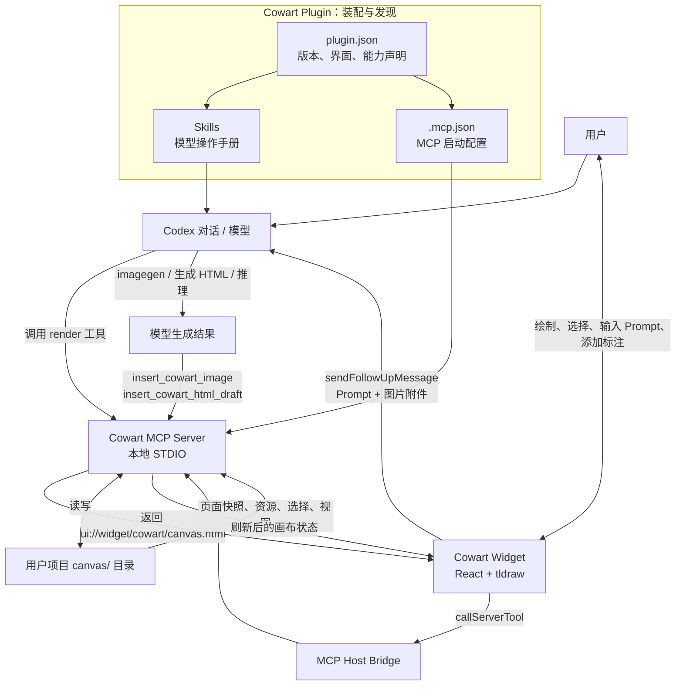
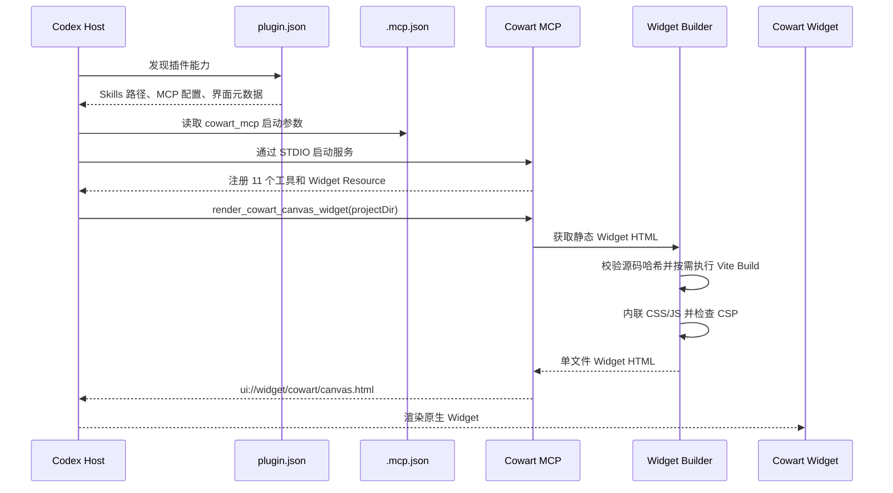
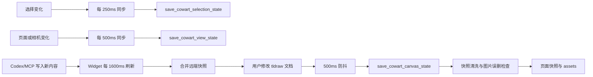
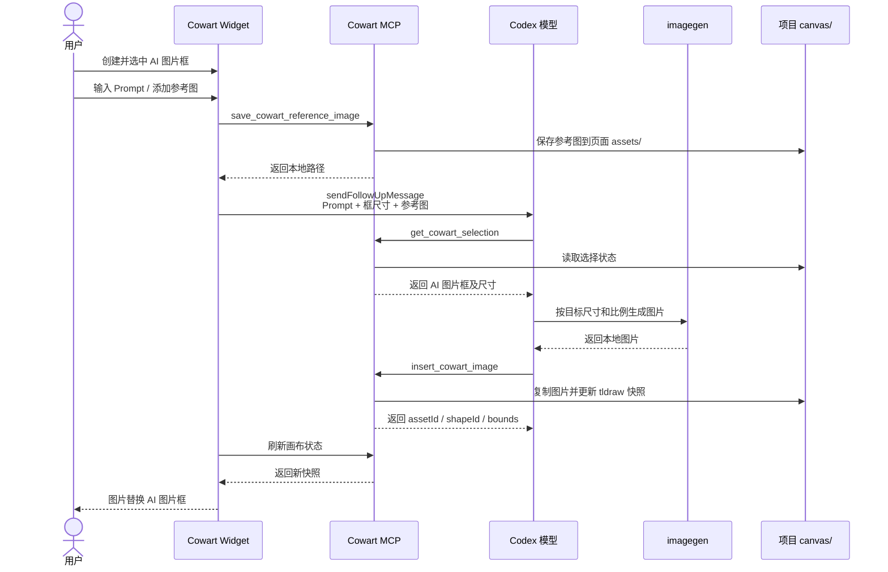
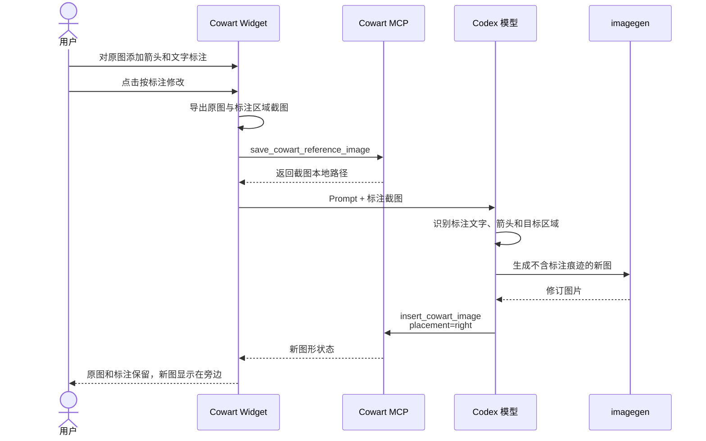
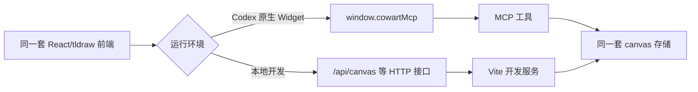

# Cowart 架构与工作流

Cowart 是一个面向 Codex 的原生无限画布插件。它把插件装配、模型工作流、可执行工具、可视化交互和项目本地存储拆分成几个职责明确的层次：

> Plugin 负责装配，Skill 负责决策，MCP 负责执行，Widget 负责交互，项目目录负责持久化。

## 1. 核心角色

| 层 | 主要职责 | Cowart 中的实现 |
| --- | --- | --- |
| Plugin | 安装、注册和能力发现 | `.codex-plugin/plugin.json` |
| Skill | 告诉模型何时调用能力、如何完成任务以及必须遵守的约束 | `skills/*/SKILL.md` |
| MCP | 执行画布读写、素材保存和内容插入 | `mcp/server.mjs` |
| Widget | 承载用户绘制、选择、输入 Prompt 和标注等交互 | React + tldraw |
| Codex 模型 | 理解意图、选择 Skill、生成内容并调用 MCP | Codex Host |
| Storage | 保存画布页面、素材、选择状态和视图状态 | 用户项目的 `canvas/` |

### 1.1 Plugin：装配层

`.codex-plugin/plugin.json` 把整个仓库声明为 Cowart 插件，并指向：

- `skills/`：让 Codex 加载 Cowart 的模型操作手册。
- `.mcp.json`：让 Codex 启动 Cowart MCP Server。
- `interface`：定义插件名称、图标、能力、默认提示词和展示信息。

Plugin 本身不操作画布，它负责把 Skill、MCP 和界面资源装配进 Codex。

### 1.2 Skill：模型决策层

当前提供三个 Skill：

- `cowart-open-canvas`：指导模型调用 `render_cowart_canvas_widget` 打开画布。
- `cowart-image-gen`：读取选中的 AI 图片框，调用图片生成能力，然后通过 MCP 插入结果。
- `cowart-image-edit`：理解用户提供的标注截图，生成干净修订图并放在原图旁边。

Skill 不直接执行代码。它定义模型需要遵守的工作流、参数契约、完成条件和安全规则。

### 1.3 MCP：执行层

`mcp/server.mjs` 通过本地 STDIO 暴露 11 个工具：

| 分类 | MCP 工具 |
| --- | --- |
| 打开界面 | `render_cowart_canvas_widget` |
| 读取状态 | `get_cowart_canvas_state`、`get_cowart_selection`、`read_cowart_page_asset` |
| 保存状态 | `save_cowart_canvas_state`、`save_cowart_selection_state`、`save_cowart_view_state` |
| 素材处理 | `save_cowart_reference_image`、`download_cowart_file` |
| 内容插入 | `insert_cowart_image`、`insert_cowart_html_draft` |

MCP 是系统的主要 seam。模型和 Widget 只需要理解相对精简的工具界面；文件安全、tldraw 记录、资源路径、图片尺寸、摆放和防误删等复杂实现都封装在 MCP 内部。

### 1.4 Widget：交互层

Widget 使用 React 和 tldraw 实现无限画布，负责：

- 绘制、编辑和选择画布形状。
- 创建 AI 图片框、AI HTML 和 AI Slides。
- 收集 Prompt、参考图和标注截图。
- 保存画布、选择状态和视图状态。
- 通过 Host Bridge 调用 MCP 工具。
- 通过 `sendFollowUpMessage` 把生成任务提交给 Codex 模型。

## 2. 总体架构



## 3. 插件加载与画布启动



Widget 静态构建会使用插件版本和源码哈希作为缓存依据。最终资源被内联成 CSP 兼容的 HTML，因此正常使用不依赖 localhost 页面。

## 4. 画布状态同步

Widget 启动后会从 MCP 加载 tldraw 快照和视图状态，并持续保存用户修改：



在原生 Widget 中，`src/cowartClient.js` 通过 `window.cowartMcp.callServerTool` 访问 MCP；在本地开发模式中，同一前端改为访问 `/api/canvas` 等 HTTP 接口。

## 5. 生成图片工作流



`insert_cowart_image` 会：

1. 读取当前快照、选择状态和视图状态。
2. 确定锚点形状和目标页面。
3. 读取图片自然尺寸。
4. 判断是否需要替换 AI 图片框。
5. 计算父级、位置、尺寸、旋转角和 fractional index。
6. 把图片复制到页面本地 `assets/`。
7. 创建 tldraw asset 和 image shape。
8. 保存更新后的画布快照。

## 6. 标注改图工作流



该流程把用户提供的截图视为权威编辑说明。MCP 只在生成完成后读取画布状态，用于确定结果的摆放位置。

## 7. AI HTML 与 AI Slides

AI HTML 和 AI Slides 当前主要由 Widget 构造结构化 Prompt：

1. Widget 收集描述、参考图、页面数量和目标形状尺寸。
2. 通过 `sendFollowUpMessage` 提交给 Codex。
3. Prompt 明确要求 Codex 生成完整单文件 HTML。
4. Codex 调用 `insert_cowart_html_draft` 写入页面资源。
5. MCP 创建或更新 tldraw embed shape。
6. 对 AI Slides，MCP 将每个 HTML 页面依次插入 Slides 容器。

图片工作流已经提炼为独立 Skill；AI HTML 和 AI Slides 的主要编排仍位于 `src/App.jsx`。如果这两类流程继续复杂化，可以进一步提炼为独立 Skill，让 Widget 更专注于输入收集、画布交互和状态展示。

## 8. 数据布局

```text
用户项目/
└── canvas/
    ├── cowart-selection.json
    ├── cowart-view-state.json
    └── pages/
        ├── manifest.json
        └── <page-id>/
            ├── cowart-canvas.json
            └── assets/
                ├── generated-image.png
                ├── reference-image.png
                └── draft.html
```

- `cowart-canvas.json`：单页 tldraw 快照。
- `assets/`：单页图片、HTML 和参考素材。
- `cowart-selection.json`：当前选择，供 Codex 精确定位操作目标。
- `cowart-view-state.json`：当前页面和相机位置。

画布数据属于用户项目，不属于插件安装目录。升级或回滚插件不应删除、覆盖或迁移这些数据。

## 9. 运行模式

Cowart 提供两种运行模式：

| 模式 | 入口 | 数据访问 | 用途 |
| --- | --- | --- | --- |
| 原生 Widget | `render_cowart_canvas_widget` | MCP Host Bridge | 正常使用和发布验收 |
| 本地开发 | `npm run dev` / `scripts/start-canvas.sh` | HTTP 接口 | UI 热更新和调试 |



开发模式和已安装的发布版插件不应同时启用，否则 Codex 可能同时发现两套同名 Cowart 工具。

## 10. 设计总结

Cowart 的主要深模块是 MCP Server：

- 对外呈现 11 个相对稳定的工具界面。
- 对内集中处理文件路径、tldraw 记录、资源复制、位置计算、快照清洗和安全校验。
- Widget、Skill 和 Codex 模型都通过同一个 seam 操作项目数据。

这一设计带来的收益是：

- **Leverage**：同一组工具同时服务 Widget、Skill 和模型直接调用。
- **Locality**：存储和画布记录相关复杂度集中在 MCP，而不是散落在 Prompt 和前端调用方。
- **可替换性**：原生 Widget 和本地开发 HTTP Adapter 可以共享同一套前端交互。
- **数据归属清晰**：用户数据始终保存在用户项目目录，插件只提供能力。

